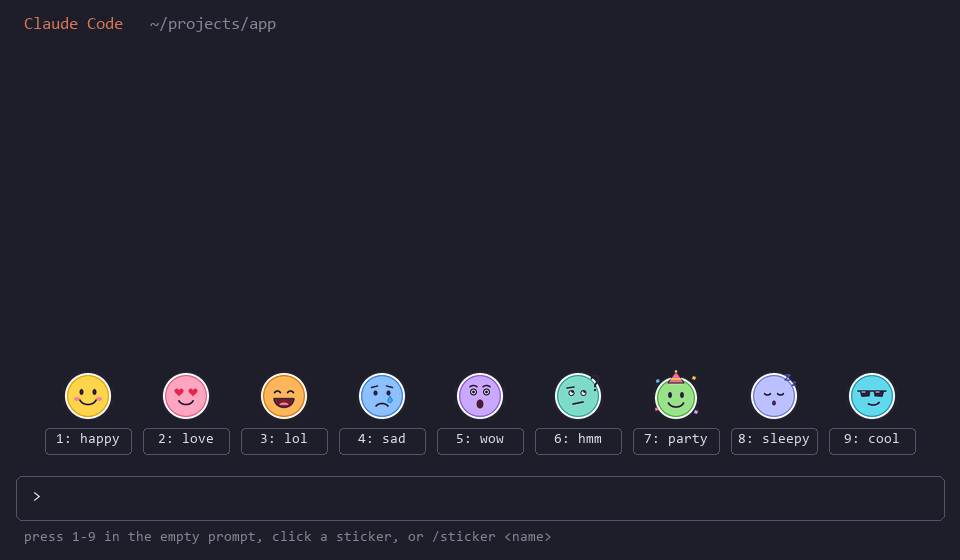
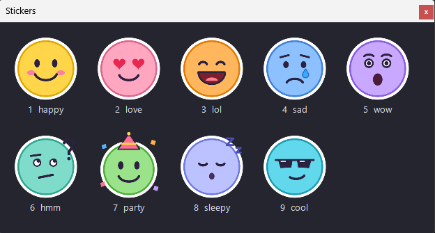

# stickers for Claude Code

A Claude Code mod that puts a sticker palette above your prompt. Send a sticker with one key or pick one from a floating sticker window, and see the stickers Claude sends back in its replies.



<sub>The animation is an illustration drawn from the pack's own PNGs, not a screen recording. It shows a kitty-graphics terminal (kitty, Ghostty). In other terminals the band shows names, and the picker window below shows the pictures; see [Where pictures show](#where-pictures-show).</sub>

The picker window, opened from the band in Windows Terminal (a real screenshot):



## What it does

- **Palette:** a row of stickers in the band above the prompt, one button per sticker.
- **Hotkeys:** type a digit `1`–`9` into the empty prompt to send that sticker at once. Clicking a button does the same.
- **Picker window:** the **pictures…** button (or `0` in the empty prompt) opens a small always-on-top window by your mouse with every sticker as a real picture, like a messenger's sticker panel. Click one, or press its number, to send it. Esc or × closes it. This works in any terminal, because the window is a native one and not drawn in the terminal.
- **`/sticker <name>`:** an instant command that runs no Claude turn. It puts the sticker in the prompt box and you press Enter to send it. `/sticker` on its own opens the picker window and puts your pick in the prompt. `/sticker list` lists the stickers. A digit works as a name too: `/sticker 3`.
- **What gets sent:** a sticker goes in as your own message, `[sticker: <description>]`, so Claude reads what the sticker shows. In the transcript the message is drawn as the sticker.
- **Stickers from Claude:** Claude is told which stickers exist. When a reply contains `:sticker:<name>:`, that text is drawn as the sticker. Tokens inside code blocks and inline code are left as they are.
- **Custom packs:** point the mod at your own folder of PNGs (see below).

## Install

You need Claude Code 2.1.296 or newer (mods are early access). At the prompt of a terminal session, run:

```
/plugin marketplace add ruslan2027/claude-stickers
/plugin install stickers@claude-stickers
```

Choose a scope (user scope loads it in every session). The palette shows up straight away.

To update later, run `/plugin marketplace update claude-stickers`, then `/reload-plugins`.

## Where pictures show

| Surface | In the band and transcript | Picker window |
| --- | --- | --- |
| Terminal with the kitty graphics protocol (kitty, Ghostty) | PNG pictures, drawn with the `Image` element | yes |
| Any other terminal (Windows Terminal, iTerm2, Terminal.app, VS Code's terminal, tmux) | Sticker names; a sticker in a reply shows as `[sticker: <description>]` | yes, with the pictures |
| Claude desktop app, IDE extensions, mobile | The sticker's SVG through the `Svg` element. A sticker with no SVG shows as the text `[sticker: <description>]`. | not needed |

Why names and not pictures in most terminals? Claude Code mods draw pictures in a terminal only through the kitty graphics protocol, which kitty and Ghostty implement. Windows Terminal, iTerm2 and the rest can't show those, and mods can't send other image protocols such as Sixel. That's why the picker opens a native window instead.

The picker window needs:

| OS | Picker | Needs |
| --- | --- | --- |
| Windows | PowerShell + WinForms | nothing extra, both ship with Windows |
| macOS | `osascript` (JavaScript for Automation + AppKit) | nothing extra. **Experimental:** not yet tested on a Mac, so please open an issue if it misbehaves. |
| Linux | Python 3 + Tk | `python3` with Tk, e.g. `sudo apt install python3-tk` |

If the window can't open, a toast says why, and the name buttons and `/sticker <name>` keep working.

## Settings

Open `/config` and find **stickers**:

| Setting | Default | What it does |
| --- | --- | --- |
| Sticker pack folder (`packDir`) | empty: the built-in pack | Folder holding your `stickers.json` and pictures. Takes an absolute path, `~/…`, or a path relative to the working directory. |
| Sticker pictures in the terminal (`pictures`) | `auto` | `auto`: pictures in kitty and Ghostty, names elsewhere. `image`: always use the kitty protocol (other terminals show `[name]`). `cells`: coarse colored character cells, which any terminal can show. `labels`: names only. |
| Let Claude send stickers (`teachClaude`) | on | Adds a short list of your stickers to Claude's system prompt so it can use `:sticker:<name>:`. Turn it off and Claude won't know about them, though tokens it writes anyway are still drawn. |

## Making your own sticker pack

1. Make a folder, e.g. `~/stickers/cats`.
2. Put one PNG per sticker in it. Square images look best, and 256×256 is plenty. Each file must be under 2 MiB.
3. Optionally add an SVG with the same name (`grumpy.svg`) for the desktop app. Without one, the desktop shows a text label for that sticker.
4. Add a `stickers.json` file:

   ```json
   {
     "stickers": [
       { "name": "grumpy", "description": "a grumpy cat glaring", "emotion": "annoyed" },
       { "name": "loaf", "description": "a cat sitting as a bread loaf", "emotion": "content" },
       { "name": "zoom", "description": "a cat sprinting past", "emotion": "excited", "file": "zoomies.png" }
     ]
   }
   ```

   - `name`: 1–32 characters, using letters, digits, `_` or `-`. You type it in `/sticker <name>` and Claude writes it as `:sticker:<name>:`. It's matched case-insensitively.
   - `description`: what the picture shows, on one line with no `]` in it. This is the text Claude reads when you send the sticker.
   - `emotion`: optional. It goes into the sticker list Claude gets.
   - `file` / `svg`: optional. They default to `<name>.png` and `<name>.svg`.
   - The first nine stickers get the hotkeys 1–9 in the order listed.

5. In `/config`, set **Sticker pack folder** to that folder. The mod reloads and reads the new pack. If something can't be read, a toast tells you what and the rest of the pack still loads.

The built-in pack under [`plugins/stickers/pack`](plugins/stickers/pack) is a working example.

## Security note

Claude Code mods run **unsandboxed with your user permissions**: the hooks module can read and write files, run commands and reach the network as you can. Read the code before you install any mod. This one:

- reads its sticker folder (the `stickers.json`, PNG and SVG files);
- reads the `HOME`/`USERPROFILE` variables to expand `~`, and `OS`, `TERM`, `TERM_PROGRAM`, `KITTY_WINDOW_ID` and `TMUX` to decide how to draw;
- runs programs only when you open the picker: `uname -s` to tell macOS from Linux, then the picker script in [`plugins/stickers/picker`](plugins/stickers/picker) with `powershell.exe`, `osascript` or `python3`. The script gets the sticker names, descriptions and PNG paths on stdin and prints the name you clicked;
- submits prompts only when you press a sticker, and fills the prompt box only when you run `/sticker`.

You can check this with `claude plugin validate plugins/stickers`, which lists every engine call the module makes.

## Development

```sh
# load the mod from this checkout for one session
claude --plugin-dir plugins/stickers

# check the manifest, the marketplace and the hooks module
claude plugin validate --strict .
claude plugin validate --strict plugins/stickers

# run the tests (tests/*.test.ts[x])
claude plugin test plugins/stickers

# redraw the default pack and the README animation
python tools/make_stickers.py
python tools/make_demo.py
```

Layout:

```
.claude-plugin/marketplace.json   the marketplace (this repo)
plugins/stickers/
  .claude-plugin/plugin.json      the mod's manifest and its settings
  hooks/register.tsx              palette, /sticker, reply rendering
  hooks/pack.ts                   pack parsing and text helpers
  hooks/picker.ts                 opening the picker window per OS
  hooks/png.ts                    PNG decoding for the cells mode
  picker/                         the picker windows: picker.ps1, picker-macos.js, picker.py
  types/index.d.ts                the mod's $.state contract
  pack/                           the default sticker pack (CC0)
  tests/                          claude plugin test suites
tools/                            generators for the pack and the demo
```

## License

The code is under the [MIT license](LICENSE). The default stickers in `plugins/stickers/pack` are original artwork drawn by `tools/make_stickers.py` and dedicated to the public domain under [CC0 1.0](plugins/stickers/pack/LICENSE).
